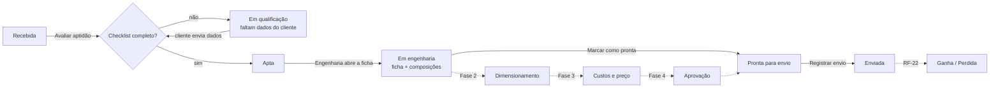
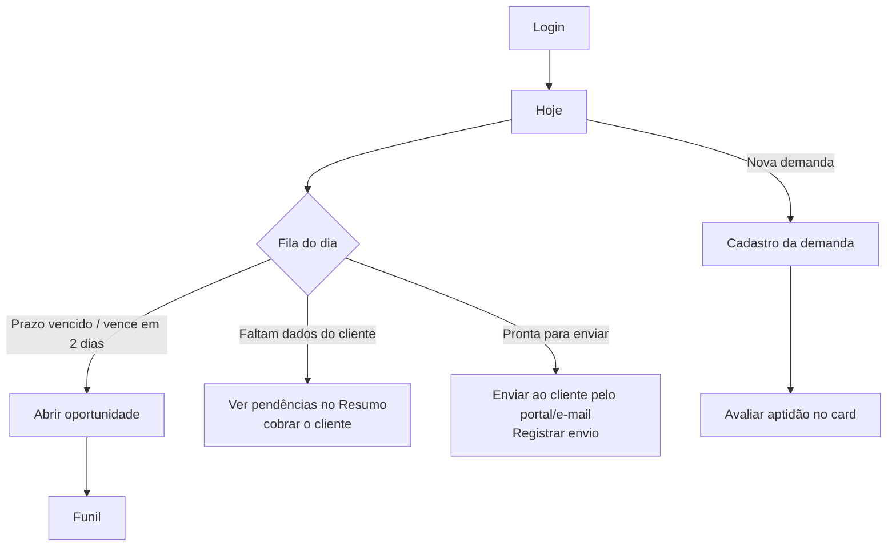
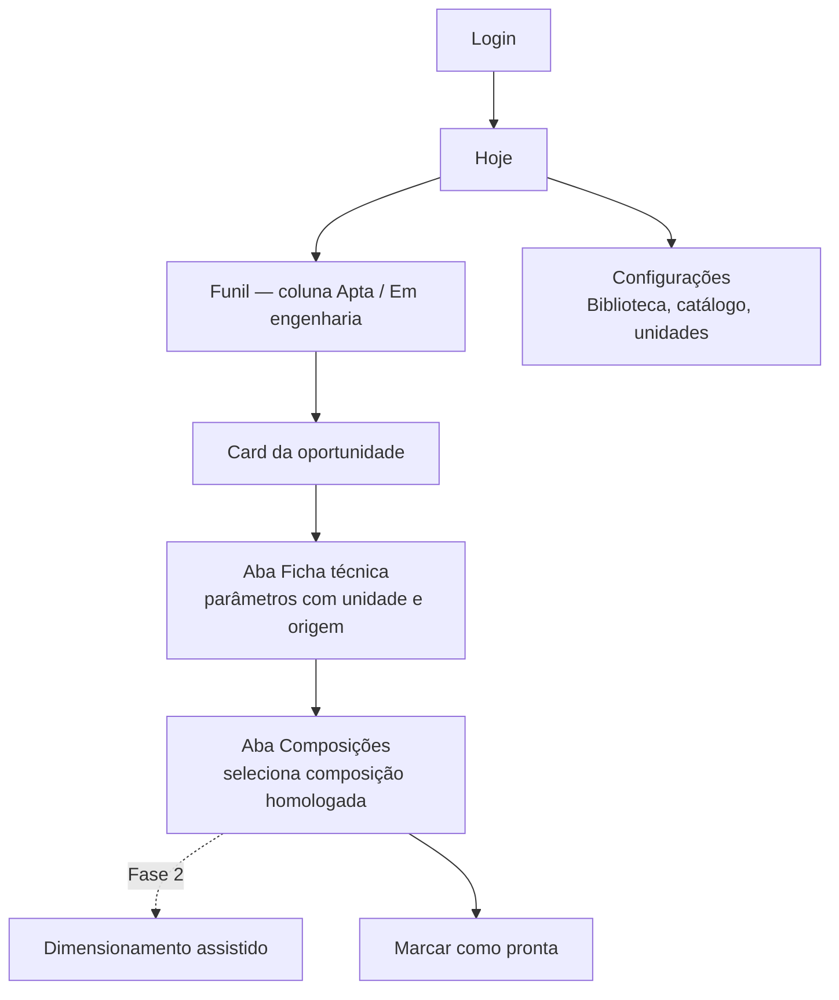
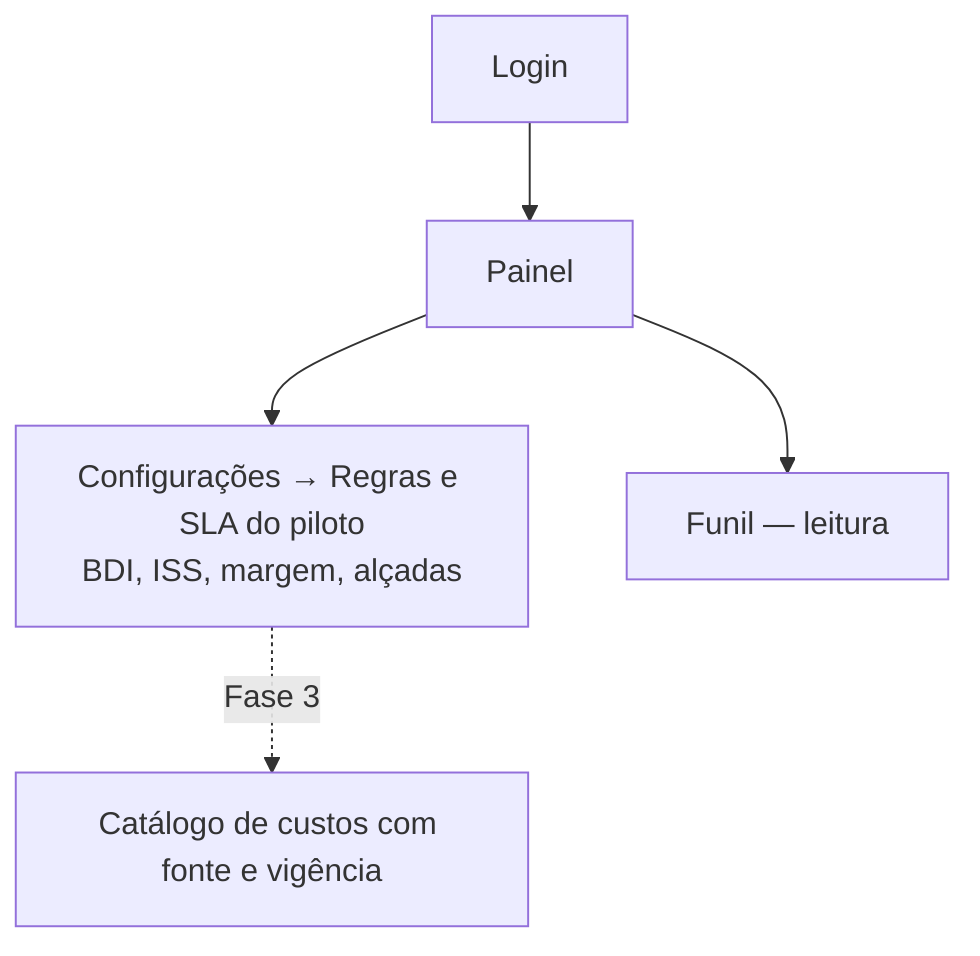
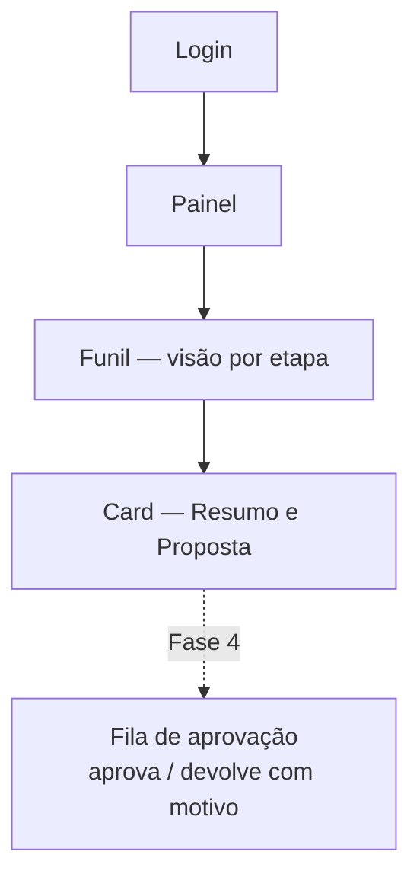
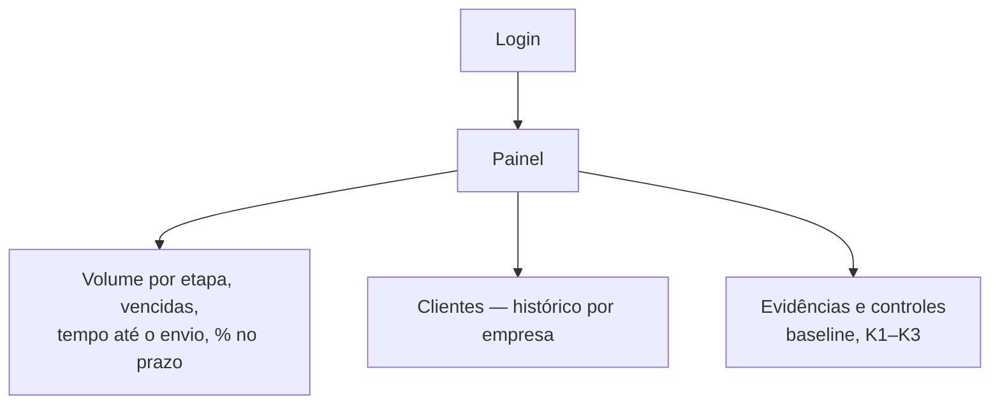

# Fluxos por perfil — Central de Propostas Mercogeo

> Quem usa o sistema, por onde entra, o que faz em cada dia e onde cada etapa mora.
> Fontes: PRD/escopo definitivo (11/09/2026), kickoff (12/08) e consultoria (01/09).
> Papéis = os 6 perfis do sistema (`src/lib/auth/permissions.ts`). Menu de cada perfil:
> `navForRole` em `src/lib/navigation.ts`.

## Mapa dos perfis

| Perfil no sistema | Quem é na Mercogeo (call de 12/08) | Começa em | Pergunta que a tela responde |
|---|---|---|---|
| **Comercial técnico** | Quem recebe a demanda do cliente e conduz o envio (engenheiros que fazem proposta "na unha") | **Hoje** | "O que eu preciso mandar, cobrar ou destravar agora?" |
| **Engenharia / orçamentista** | Gustavo Miranda (líder do projeto), Rafael (trainee) e engenheiros | **Hoje** | "Qual proposta está esperando a minha parte técnica?" |
| **Financeiro / administrativo** | Luiz Miranda (diretor financeiro) | **Painel** | "Os parâmetros de custo e preço estão homologados e em dia?" |
| **Aprovador** | Paulo Romeiro (CEO — revisa e define preço) | **Painel** | "O que precisa da minha decisão e como está o volume?" |
| **Gestão** | Diretoria / sócios | **Painel** | "Estamos respondendo rápido e dentro do prazo?" |
| **Administrador** | Consultoria e TI | **Hoje** | Tudo, mais evidências e controles |

Fora do sistema hoje: o **técnico de campo** (ex.: Ney) que faz a visita técnica. Os registros de visita entram como documento da oportunidade (RF-03) por quem os recebe; um perfil "Campo" só faz sentido quando a visita for registrada no próprio sistema.

## Menu de cada perfil

| Item | Comercial | Engenharia | Financeiro | Aprovador | Gestão | Admin |
|---|:-:|:-:|:-:|:-:|:-:|:-:|
| Hoje | ● | ● | | | | ● |
| Funil de propostas | ● | ● | ● | ● | ● | ● |
| Demandas | ● | ● | ● | ● | ● | ● |
| Clientes | ● | ● | ● | ● | ● | ● |
| Ficha técnica | ● | ● | | | | ● |
| Biblioteca técnica | ● | ● | | | | ● |
| Painel | ● | ● | ● | ● | ● | ● |
| Configurações | | ● | ● | | | ● |
| Evidências e controles | | ● | | | ● | ● |

O menu é conveniência; quem decide o que cada um pode ler ou alterar é o servidor.

## A jornada da oportunidade (o objeto central)

Linhas tracejadas = etapas que ainda não existem no backend. No sistema elas aparecem tracejadas na régua da jornada, com a fase em que chegam; não há coluna falsa no funil.

## Fluxo — Comercial técnico

1. Abre em **Hoje**: quatro números (em andamento, vencidas, vencem em 2 dias, prontas para enviar) e a fila agrupada por urgência.
2. Recebeu uma demanda nova → **Nova demanda** (botão laranja) → cadastro → abre o card e clica **Avaliar aptidão**.
3. Se o checklist bloquear, o card mostra exatamente o que falta; o comercial cobra o cliente e reavalia.
4. Quando a engenharia marca **pronta**, a oportunidade aparece em "Prontas para enviar"; depois de enviar pelo portal do cliente (Ariba, ME…), clica **Registrar envio** — o relógio do K1 fecha aí.

## Fluxo — Engenharia / orçamentista

- O trabalho técnico acontece **dentro do card**, nas abas Ficha técnica e Composições, já no contexto da oportunidade (sem procurar IDs).
- Cadastros de base (biblioteca, catálogo, unidades) ficam em **Configurações**, fora do caminho do dia a dia.
- Provas e controles do método (baseline, gates, prova do cálculo) ficam em **Evidências e controles**.

## Fluxo — Financeiro

Hoje o financeiro mantém os parâmetros homologados; o catálogo de custos e a formação de preço chegam na Fase 3 e vão aparecer na aba **Proposta** do card.

## Fluxo — Aprovador (Paulo)

A fila de aprovação (RF-16/RF-17) entra na Fase 4; até lá o aprovador acompanha pelo Painel e pelo Funil.

## Fluxo — Gestão

## Decisões pendentes que mudam os fluxos

1. **Visão do time.** Hoje o servidor só deixa cada pessoa ver as oportunidades em que ela é a responsável (`listRule` de `opportunities`). Aprovador e Gestão precisam ver **todas** para o Painel e o Funil fazerem sentido. Exige mudança de regra de acesso no servidor (decisão da consultoria + Mercogeo).
2. **Cadastro de clientes.** Clientes hoje são derivados do nome digitado na demanda. Um cadastro próprio (empresa → contatos → oportunidades) é emenda leve do RF-01.
3. **Desfecho ganha/perdida (RF-22).** Fecha o funil e libera taxa de conversão e motivo de perda no Painel.
4. **Perfil Campo.** Só quando a visita técnica for registrada no sistema.
